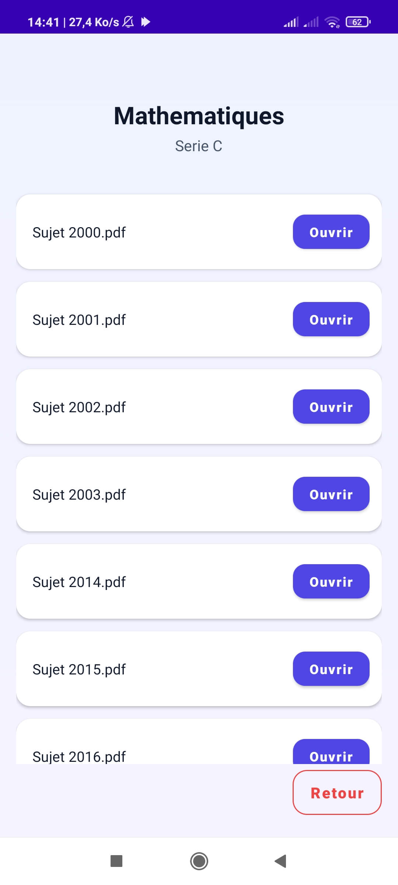
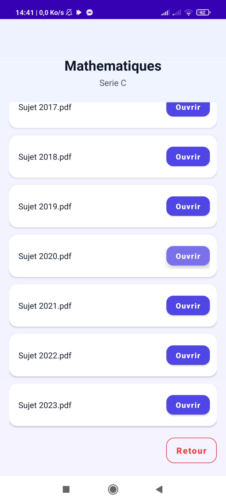
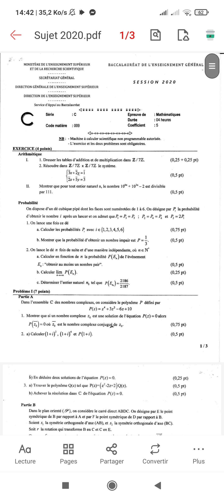

Set-Content -Path README.md -Encoding UTF8 -Value @'
# JBacc - Révision Bac Madagascar

Application Android de révision pour les élèves de Terminale à Madagascar.

---

## Fonctionnalités

- **Sujets d'examen** : annales officielles du Bac malgache de 1999 à 2023.
- **Corrigés** : disponibles pour plusieurs matières et séries.
- **Organisation claire** : navigation par parcours, série, matière, puis document.
- **Tri automatique** : les sujets apparaissent avant les corrigés.
- **Visualisation externe** : ouverture des PDF, images et présentations via l'application de votre choix.
- **Partage facile** : envoi d'un document vers une autre application.

---

## Captures d'écran

### Navigation

| # | Écran | Description |
|---|-------|-------------|
|  | **Icône** | Logo JBacc sur le lanceur |
|  | **Accueil** | Choix du parcours : Scientifique ou Littéraire |
|  | **Série** | Sélection de la série A1 ou A2 |
|  | **Série** | Sélection de la série C OU D |
|  | **Matières** | Liste des 8 matières disponibles |
|  | **Sujets** | Sujets et corrigés de la matière choisie |
|  | **Sujets** | Sujets et corrigés de la matière choisie |
|  | **PDF** | Visualisation d'un sujet via le lecteur externe |

---

## Matières couvertes

- Mathématiques
- Physique-Chimie
- Sciences de la Vie et de la Terre (SVT)
- Histoire-Géographie
- Malagasy
- Philosophie
- Anglais
- Français

---

## Séries disponibles

- Série C
- Série D
- Série A1
- Série A2

---

## Téléchargement

| Fichier | Version | Taille |
|---------|---------|--------|
| JBacc-1.3-release.apk | 1.3 | ~120 Mo |

---

## Prérequis

- Android 7.0 (API 24) ou supérieur.
- Un lecteur PDF installé (Google Drive, Adobe Acrobat, MuPDF, etc.).

---

## Installation

1. Téléchargez le fichier `JBacc-1.3-release.apk`.
2. Activez « Sources inconnues » dans Paramètres → Sécurité.
3. Ouvrez le fichier APK et appuyez sur « Installer ».
4. Lancez l'application JBacc.

Remarque : si une version antérieure de JBacc est installée avec une signature différente, désinstallez-la avant d'installer la nouvelle version.

---

## Contenu disponible

### Sujets par série et par matière

| Matière | Série A | Série C | Série D |
|---------|---------|---------|---------|
| Mathématiques | 1999-2023 | 2000-2023 | 1998-2023 |
| Physique-Chimie | 2014-2023 | 2005-2023 | 1999-2023 |
| SVT | 2014-2023 | 2013-2023 | 2000-2023 |
| Histoire-Géographie | commun A/C/D : 1999-2023 | | |
| Malagasy | 2013-2023 | commun C/D : 2013-2023 | |
| Philosophie | 2013-2022 | commun C/D : 2013-2023 | |
| Anglais | 2015-2022 | commun C/D : 2015-2023 | |
| Français | 2013-2023 | commun C/D : 2013-2023 | |

### Corrigés

Les corrigés sont fournis pour les matières suivantes, lorsque disponibles :
- Mathématiques (séries A et D)
- Physique-Chimie (séries A, C et D)
- SVT (séries A et D)

---

## Notes de version

### Version 1.3

- Refonte complète de l'interface : thème Material, couleurs harmonisées, boutons arrondis.
- Suppression du module Leçons : l'application se concentre sur les sujets et corrigés.
- Ajout de la matière Français.
- Extension des séries couvertes (A1, A2, C, D) pour toutes les matières.
- Tri automatique : sujets avant corrigés dans chaque liste.
- Compression des PDF : réduction d'environ 27 % de la taille des assets (150 Mo → 111 Mo).
- Optimisation mémoire : cache des listes d'assets, recyclage des vues via RecyclerView.
- Configuration R8 full mode, resource shrinking et baseline profile pour des performances optimales.
- Correction du thème : passage à Theme.MaterialComponents pour éviter le plantage au démarrage.

### Version 1.2

- Version initiale stable.
- Navigation par parcours et série.
- Visualisation des PDF.

---

## Auteur

Johanès Falitiana

## Licence

MIT

---

## Remerciements

Les contenus pédagogiques (sujets et corrigés) proviennent de :

- CNTEMAD
- Lycée Présentation de Marie
- Autres établissements scolaires ayant contribué à la diffusion des ressources éducatives.

Les sources ne sont pas produites par l'auteur du projet. Elles sont citées dans les documents respectifs.

---

*« Le succès n'est pas un hasard, mais le résultat de la persévérance et du travail. »*
'@
